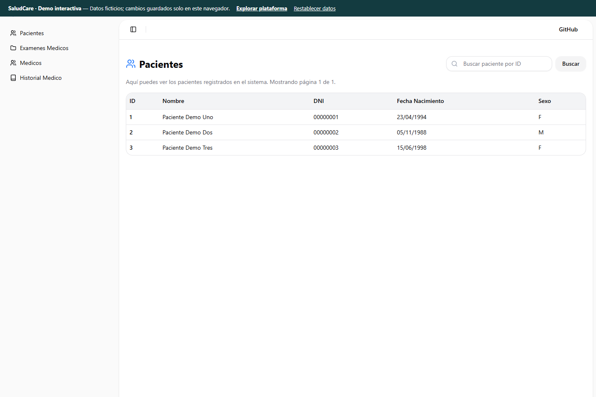

# SaludCare

Plataforma de gestión médica con pacientes, médicos, exámenes y resúmenes.

**Edición de portafolio de Ronal Condor · proyecto académico colaborativo.**

**Mi participación:** diseño y desarrollo frontend con Next.js y TypeScript para los módulos de pacientes, médicos, resúmenes e historial de exámenes.

[Proyecto original](https://github.com/DarKNeSsJuaN25/proyecto) · [Mis commits originales](https://github.com/DarKNeSsJuaN25/proyecto/commits/master/?author=ronaljcb) · [Mi participación y arquitectura](docs/CONTRIBUTIONS.md)

[](https://saludcare-three.vercel.app) 



**[Abrir demo interactiva](https://saludcare-three.vercel.app)**

## Explorar

Consulta de pacientes, alta de médicos, búsqueda de resúmenes y gestión de exámenes.

La demo funciona sin las cuentas ni los servidores antiguos de AWS. Los datos son **ficticios**, las modificaciones se guardan en **localStorage del navegador** y pueden restablecerse desde la barra superior. No hay base de datos compartida, autenticación de producción, pagos reales ni recuperación de registros históricos. No introduzcas contraseñas reales o información personal.

Pulsa **Explorar plataforma**. Los módulos están disponibles sin registro.

## Tecnología

Next.js · React · TypeScript · Python · Node.js · Java.

## Ejecutar localmente

Requiere Node.js 22 y npm.

```sh
npm install
npm run dev
```

El comando raíz delega la aplicación en `Frontend/`.

```sh
npm run build
```

## Despliegue

Importa este repositorio en Vercel y configura **Root Directory** como `Frontend`. La configuración `vercel.json` de esa carpeta define el despliegue. El modo demo está habilitado de forma predeterminada.

## Arquitectura y recuperación

Consulta [la migración desde AWS](docs/MIGRATION.md), [la procedencia y revisiones originales](docs/PROVENANCE.md) y [las comprobaciones realizadas](docs/VERIFICATION.md).

Los créditos del equipo y la documentación académica original se conservan en los archivos originales. Esta edición organiza y adapta ese trabajo; no atribuye a una sola persona la autoría de todo el proyecto.
