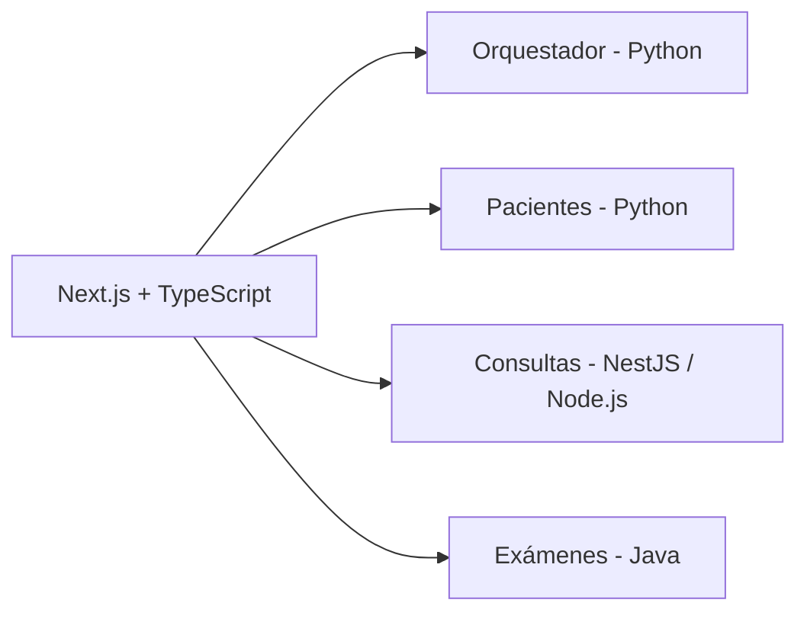

# Mi participación en SaludCare

SaludCare es un proyecto académico de equipo que integra servicios médicos. Mi participación se centra en el frontend y el diseño de interfaces.

## Trabajo de Ronal Condor

- Desarrollo de interfaces con Next.js y TypeScript para pacientes, médicos, resúmenes e historial de exámenes.
- Construcción de la experiencia de navegación y de consulta de información del sistema.
- Trabajo de integración del frontend con los contratos de las APIs del proyecto.

## Evidencia del historial original

- [Commits de ronaljcb en el repositorio original](https://github.com/DarKNeSsJuaN25/proyecto/commits/master/?author=ronaljcb).
- [Commit 4ea67de: módulos y estructura del frontend](https://github.com/DarKNeSsJuaN25/proyecto/commit/4ea67de799eef05bf87960f3a9a95bdb1ec66914).
- [Repositorio original y documentación del equipo](https://github.com/DarKNeSsJuaN25/proyecto).

## Arquitectura del equipo

La arquitectura incluye Node.js/NestJS, Python y Java como tecnologías del proyecto del equipo. Su presencia en el repositorio no implica que yo haya desarrollado personalmente todos los microservicios.

La [demo de portafolio](https://saludcare-three.vercel.app) conserva las interfaces y utiliza datos ficticios con persistencia en el navegador. Los microservicios y las bases de datos originales no se ejecutan en ese despliegue.

Consulta también [la migración](MIGRATION.md), [la procedencia](PROVENANCE.md) y [la verificación](VERIFICATION.md).
